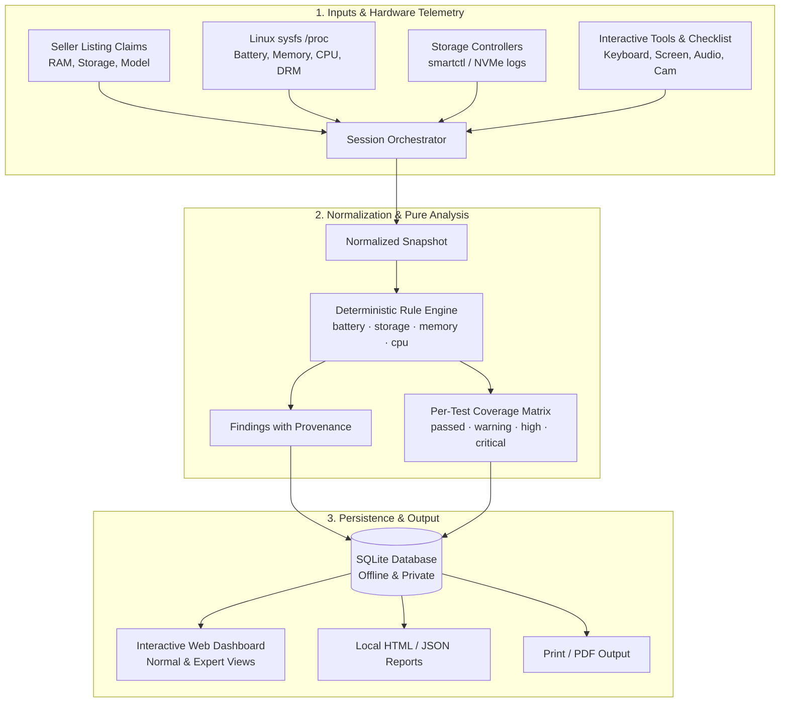

# Aegis Laptop Diagnostics (Laptop Buyer Kit v2.0)

<p align="center">
  
</p>

<p align="center">
  <strong>The offline-first, evidence-based hardware diagnostic and used-laptop buyer assurance platform.</strong>
</p>

<p align="center">
  <a href="https://github.com/PixelApprentice/laptop-buyer-kit/actions"></a>
  <a href="https://github.com/PixelApprentice/laptop-buyer-kit/releases"></a>
  <a href="LICENSE"></a>
  <a href="https://python.org"></a>
  <a href="#zero-trust-offline-architecture"></a>
  <a href="#playwright-e2e-testing"></a>
</p>

---

## 💡 Why Aegis Laptop Diagnostics?

Buying a used, refurbished, or marketplace laptop carries significant risk. Sellers often quote advertised specs while hiding degraded batteries, counterfeit drives, overheating components, or intermittent keyboards and trackpads.

Most diagnostic tools suffer from critical drawbacks:
- **Cloud-dependent:** Require internet access, risk leaking device identifiers, or upload reports to third-party databases.
- **Deceptive precision:** Aggregate complex hardware states into an arbitrary "95% Health" number that conceals critical disk or battery faults.
- **Aggressive accusations:** Flag legitimate replacement parts or firmware quirks as "fraud" without presenting verifiable evidence.
- **Missing coverage transparency:** Assume that if a sensor didn't report an alarm, the hardware passed.

**Aegis (Laptop Buyer Kit v2.0)** is built from the ground up to solve these problems. It is **100% offline**, **read-only**, **evidence-backed**, and features a modern cybernetic interface with **Normal Mode** for casual buyers and **Expert Mode** for deep technical diagnostics.

---

## 🚀 Key Features in Version 2.0

```
┌────────────────────────────────────────────────────────────────────────┐
│                   AEGIS LAPTOP DIAGNOSTICS v2.0.0                      │
│                                                                        │
│   [1. Auto-Detection Engine]       [2. Dual Normal / Expert Modes]     │
│   • Instant hardware register probe• Normal mode for casual buyers     │
│   • Seller claim vs detected table • Expert mode: thermals & registers │
│   • Radial battery & NVMe gauges   • Custom degradation thresholds     │
│                                                                        │
│   [3. Interactive Diagnostic Suite][4. Provenance & Offline Storage]   │
│   • Dead pixel RGB screen cycler   • 100% offline SQLite archive       │
│   • Audio frequency sweep (20-8kHz)• Zero external CDNs / tracking     │
│   • Webcam & live mic dB analyzer  • Instant HTML, JSON & Print export │
│   • Trackpad gesture drawing canvas│                                   │
│   • Interactive keyboard visualizer│                                   │
└────────────────────────────────────────────────────────────────────────┘
```

### 1. ⚡ Local Hardware Auto-Detection Engine
- Instantly probes host hardware registers via `/api/probe` with a single click.
- Extracts vendor, model, physical RAM GiB, storage disk capacity, CPU model, GPU controller, and native display resolution without manual typing.
- Auto-populates the **Claim Comparison Matrix** to immediately detect seller listing discrepancies.

### 2. Normal Mode vs. Expert Mode
- **Normal Mode:** Streamlined, buyer-oriented view presenting the overarching Hardware Assurance Verdict, visual health dials, and actionable recommendations.
- **Expert Mode:**
  - **Tuning Sliders:** Customize warning thresholds for battery degradation (10%–35%) and NVMe lifetime wear (50%–95%).
  - **Package & Core Thermals:** Live CPU temperature display with throttle-risk triage.
  - **Telemetry Grid:** Detailed low-level tables for CPU topology, battery ACPI registers, raw NVMe critical warning bitmasks, and motherboard/DRM display modes.

### 3. Visual Health Gauges & Agreement Matrix
- **Radial Battery Ring:** Visual gauge of current full-charge capacity vs. design capacity with health percentage and cycle count.
- **Storage Endurance Bar:** Visual representation of NVMe percentage used, spare threshold, and media errors.
- **Claim Comparison Matrix:** Side-by-side reconciliation of seller listing claims vs. physical hardware, flagging matches, iGPU VRAM reservation tolerances, and discrepancies.

### 4. Expanded Interactive Hardware Testing Suite
- **🖥️ Dead & Stuck Pixel Screen Tester:** Fullscreen pure color cycling (Monochrome, RGB, Yellow, Magenta, Cyan) to spot dead subpixels, pressure marks, and backlight bleed.
- **🔊 Audio Frequency & Speaker Rattle Tester:** Web Audio API sine oscillator (20Hz–8000Hz), 5-second linear frequency sweep, and Left/Right channel isolation to identify blown speaker cones and chassis rattle.
- **📷 Webcam & Microphone Diagnostic:** Real-time camera preview paired with live microphone decibel (dB) metering and voice activity detection.
- **🖱️ Trackpad & Gesture Canvas:** Multi-touch pointer tracking, gesture recognition, and 2-finger scroll test canvas.
- **⌨️ Keyboard Matrix Tester:** Interactive virtual keyboard illuminating every registered physical key switch.

### 5. Local Offline Database & Session History
- Persistent SQLite storage (`~/.local/share/laptop-buyer-kit/inspections.sqlite3`).
- Tracks historical inspections, claims, findings, and per-test coverage states.
- One-click export to standalone local HTML reports, JSON snapshots, or print-ready PDF views.

---

## 🏛 Architecture & Data Flow



---

## 📦 Installation

Aegis Laptop Diagnostics requires **Python 3.10+**. The core analysis engine, SQLite persistence layer, and local web dashboard use **zero external runtime dependencies**.

```bash
# Clone the repository
git clone https://github.com/PixelApprentice/laptop-buyer-kit.git
cd laptop-buyer-kit

# Create and activate virtual environment
python3 -m venv .venv
source .venv/bin/activate  # On Windows: .venv\Scripts\Activate.ps1

# Install in editable mode
pip install -e .
```

---

## 🖥 Quickstart & Usage

### 1. Launch the Interactive Local Dashboard (Recommended)

Start the local web dashboard with a single command:

```bash
laptop-inspector serve --port 8080
```

Open your browser to **`http://127.0.0.1:8080`**:
1. Click **⚡ Auto-Detect Specs** to probe the laptop hardware automatically, or enter seller claims manually.
2. Click **Run Full Hardware Diagnostic** (on Linux) or click **Load Reference Sample** to preview.
3. Switch between **Normal** and **Expert** modes using the top-right toggle.
4. Visit the **Interactive Tools** tab to test screen pixels, audio frequencies, camera/mic, trackpad, and keyboard.
5. Review the **Verdict**, **Findings Cards**, and **Listing Claim Comparison Matrix**.
6. Click **Download HTML Report** to save an offline report for purchase negotiations.

### 2. Command-Line Analysis of Snapshot JSON

You can also run offline analysis directly in the terminal:

```bash
# Output formatted JSON analysis to stdout:
laptop-inspector examples/sample_session.json --format json

# Generate an offline HTML report:
laptop-inspector examples/sample_session.json --format html --output report.html
```

---

## 🔒 Zero-Trust Offline Architecture

| Property | Guarantee |
|---|---|
| **Network Calls** | **Zero.** The server binds to `127.0.0.1`. No external APIs, CDNs, or telemetry are queried. |
| **Data Privacy** | Hardware serial numbers, MAC addresses, and UUIDs are redacted from shareable reports. |
| **Drive Safety** | 100% read-only. No write passes, partition modifications, or destructive erase tools are ever called. |
| **Missing Data Policy** | Missing data is recorded as `inconclusive` or `skipped`—never silently reported as `pass`. |

---

## 🧪 Automated Testing & QA

Aegis Laptop Diagnostics maintains an automated test suite including unit tests and Playwright browser integration tests:

```bash
# Install test dependencies (Playwright)
pip install -e ".[test]"
playwright install chromium

# Run all 52 unit and Playwright integration tests:
python -m unittest discover -s tests -v
```

### Test Coverage Highlights:
- **`BatteryTests`:** Degradation boundaries, low-cycle discrepancies, zero full capacity (`critical`), negative/implausible cycles, above-design thresholds.
- **`StorageTests`:** Low-wear media errors, NVMe critical warning bitmask decoding, invalid negative counters, decimal GB vs. GiB storage matching.
- **`MemoryTests`:** Material RAM shortfalls, reserved VRAM tolerance, zero-byte invalid memory handling.
- **`DatabaseTests`:** SQLite schema initialization, transaction safety, session persistence, manual check synchronization, cascade deletions.
- **`LinuxCollectorFixtureTests`:** Synthetic sysfs power supply parsing, charge-to-energy conversion, `/proc/meminfo` total bytes, CPU topology, display DRM modes, thermal zone sensors, and auto-detection specs.
- **`UITestsPlaywright`:** End-to-end headless Chromium tests validating Auto-Detect specs query, Normal vs Expert mode toggles, sample analysis, health dials, claim comparison matrix, evidence toggles, manual checklist interactions, interactive tools suite (screen, audio, webcam, trackpad, keyboard), history SQLite view, and About/Donate page.

---

## 👨‍💻 Author & Maintainer

Created with pride by **[PixelApprentice](https://github.com/PixelApprentice)**.

- **GitHub:** [@PixelApprentice](https://github.com/PixelApprentice)
- **Project Repository:** [github.com/PixelApprentice/laptop-buyer-kit](https://github.com/PixelApprentice/laptop-buyer-kit)

---

## 💖 Support & Donate

Aegis Laptop Diagnostics is completely free and open source. If this software helped you test a used laptop, save money, or avoid purchasing damaged hardware, please consider supporting ongoing development:

- **GitHub Sponsors:** [sponsor @PixelApprentice](https://github.com/sponsors/PixelApprentice)
- **Ko-fi:** [ko-fi.com/PixelApprentice](https://ko-fi.com/PixelApprentice)
- **Buy Me a Coffee:** [buymeacoffee.com/PixelApprentice](https://buymeacoffee.com/PixelApprentice)

### Crypto Support
| Coin | Address |
|---|---|
| **Bitcoin (BTC)** | `bc1qpixelapprenticeusedlaptopkitbtc89x` |
| **Ethereum (ETH)** | `0xPixelApprenticeLaptopBuyerKitEth77a` |
| **Monero (XMR)** | `888tXMRPixelApprenticePrivateLaptopFund99x` |

---

## 🗺 Roadmap for Future Versions

- [ ] Native Windows CIM/WMI hardware collector adapter (`Windows 10/11`)
- [ ] Native macOS `system_profiler` / IOKit telemetry adapter (Intel & Apple Silicon)
- [ ] Bootable live-USB Linux image generation
- [ ] Cryptographic report signing with local buyer key pairs
- [ ] Model reference specs database for popular ThinkPad, Latitude, EliteBook, and MacBook models

---

## 📄 License

This project is licensed under the [MIT License](LICENSE).
