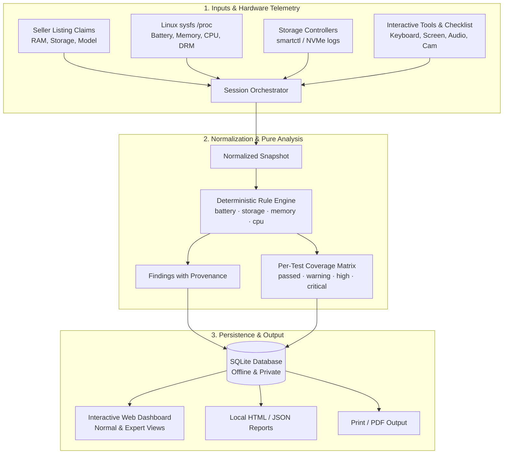

# Aegis Laptop Diagnostics (Laptop Buyer Kit v2.1)

<p align="center">
  
</p>

<p align="center">
  <strong>The offline-first, evidence-based hardware diagnostic and used-laptop buyer assurance platform.</strong>
</p>

<p align="center">
  <a href="https://github.com/PixelApprentice/laptop-buyer-kit/actions"></a>
  <a href="https://github.com/PixelApprentice/laptop-buyer-kit/releases"></a>
  <a href="LICENSE"></a>
  <a href="https://python.org"></a>
  <a href="#zero-trust-offline-architecture"></a>
  <a href="#playwright-e2e-testing"></a>
</p>

---

## 💡 Why Aegis Laptop Diagnostics?

Buying a used, refurbished, or marketplace laptop carries significant risk. Sellers often quote advertised specs while hiding degraded batteries, counterfeit drives, overheating components, or intermittent keyboards and trackpads.

Most diagnostic tools suffer from critical drawbacks:
- **Cloud-dependent:** Require internet access, risk leaking device identifiers, or upload reports to third-party databases.
- **Deceptive precision:** Aggregate complex hardware states into an arbitrary "95% Health" number that conceals critical disk or battery faults.
- **Aggressive accusations:** Flag legitimate replacement parts or firmware quirks as "fraud" without presenting verifiable evidence.
- **Missing coverage transparency:** Assume that if a sensor didn't report an alarm, the hardware passed.

**Aegis (Laptop Buyer Kit v2.1)** is built from the ground up to solve these problems. It is **100% offline**, **read-only**, **evidence-backed**, and features a modern cybernetic interface with **Normal Mode** for casual buyers and **Expert Mode** for deep technical diagnostics.

---

## 🚀 Key Features in Version 2.1

```
┌────────────────────────────────────────────────────────────────────────┐
│                   AEGIS LAPTOP DIAGNOSTICS v2.1.0                      │
│                                                                        │
│   [1. OS & Clean-Wipe Detection]   [2. Display Panel & EDID Parsing]   │
│   • UEFI vs BIOS/MBR boot type     • OLED/AMOLED vs IPS/TN panel type  │
│   • GPT partition table & root fs  • Color depth (10-bit HDR) & size   │
│   • CPU arch (x86_64/ARM/32/64)    • Touchscreen hardware detection    │
│   • Resale clean-wipe detection    • Contrast ramp & UFO Hz benchmark  │
│                                                                        │
│   [3. Input Stress & Weakpoints]   [4. Cooling & Fan Profiles]         │
│   • Trackpad 9-zone sensitivity map• ACPI profile: Whisper vs Max Speed│
│   • Real-time pointer pressure API • Live fan RPM monitoring (hwmon)   │
│   • Switch chatter & bounce (<35ms)• 5s bounded thermal dissipation    │
│   • Keyboard condition heatmap     • Throttle velocity & delta rise    │
│                                                                        │
│   [5. Ports & Connectors Station]  [6. USB Portable / Autorun Mode]    │
│   • USB-A / Type-C speed & vendor  • Windows autorun.inf & batch run   │
│   • HDMI & DisplayPort outputs     • UAC elevation manifest (.manifest)│
│   • AC adapter charging detection  • 100% offline SQLite & HTML export │
└────────────────────────────────────────────────────────────────────────┘
```

### 1. ⚡ OS, Boot Architecture & Resale Clean-Wipe Detection
- **Boot & Architecture:** Detects UEFI vs. legacy BIOS/MBR, CPU architecture (x86_64, aarch64, i686) and 32-bit vs. 64-bit operating mode.
- **Storage Partition Table & Filesystem:** Queries block devices for GPT vs. MBR partition table schemes and primary root filesystem types (ext4, btrfs, NTFS, exFAT).
- **Clean OS Reinstall vs. Storage Runtime Discrepancy:** Inspects operating system installation timestamps (pacman.log, Debian/Ubuntu installer logs, `/etc/machine-id`) and reconciles against storage power-on hours to detect when a heavily used laptop was wiped right before being listed on the used marketplace.

### 2. 🖥️ Display Panel EDID Parsing & Touchscreen Detection
- **Panel Technology Identification:** Direct binary EDID parser decoding manufacturer (Samsung Display, BOE, LG Display, AUO, Sharp), panel model, diagonal inches, and pixel color depth (6-bit, 8-bit, 10-bit).
- **OLED vs. IPS vs. TN:** Automatically identifies self-emitting OLED/AMOLED panels vs. wide-angle IPS vs. budget TN displays.
- **Touchscreen Sensor:** Verifies presence of capacitive or active digitizer touchscreen controllers.
- **Screen Studio:** 16-step grayscale contrast ramp, 1px subpixel checkerboard test, and a live UFO motion blur animation that measures exact browser compositor refresh rates (Hz) and frame times.

### 3. 🖱️ Trackpad Weakpoints & Keyboard Switch Chatter Detection
- **9-Zone Sensitivity Matrix:** Real-time 3x3 tracking grid (Top-Left, Center, Bottom-Right, etc.) showing hit counts across the trackpad to identify dead spots, unresponsive edges, or sticky click corners.
- **Pointer Pressure API:** Scales contact radius and displays real-time pointer pressure (0%–100%) on force-sensitive touchpads.
- **Switch Chatter & Bounce Detection:** Monitors key press intervals down to millisecond precision; flags contact bounce (<35ms) and switch wobble to identify physically worn or failing key switches.
- **Condition Heatmap:** Color-codes every key switch on the laptop keyboard (Cold, Warm, Verified, Chatter Alert).

### 4. 🌀 ACPI Fan Acoustics & Performance vs. Whisper Mode
- **ACPI Platform Cooling Profiles:** Toggle vendor firmware profiles directly from the dashboard:
  - `🚀 Performance Mode`: Spins fans to maximum speed and raises thermal limits to test peak cooling and airflow.
  - `🤫 Whisper Mode`: Keeps fans in silent low-RPM operation to verify bearing noise and quiet dissipation.
  - `⚖️ Balanced Mode`: Restores standard factory thermal policy.
- **Live Fan RPM Monitor:** Non-destructive read-only hwmon sysfs monitoring displaying current fan rotation speeds in real time.
- **5-Second Bounded Thermal Pulse:** Non-destructive math calculation measuring starting idle temp, peak temp, rise delta, and ramp velocity (°C/s).

### 5. 🔌 Physical Ports & Connectors Hardware Station
- **Live USB Verification:** Plug a USB drive or peripheral into any chassis port to immediately see speed classification (USB 2.0 480M, USB 3.0 5G, USB 3.2 10G) and removable flag.
- **External Video Connectors:** Validates HDMI and DisplayPort output interfaces and modes.
- **AC Charging Port:** Real-time confirmation of AC power delivery and battery charge status.

### 6. 💽 USB Bootable & Portable Mode (Windows + Linux)
- Includes `autorun.inf`, `start-aegis.bat`, and `start-aegis.manifest` for plug-and-play USB operation.
- Requests standard UAC administrator elevation so Aegis can access SMART registers and ACPI telemetry without false-positive virus flags (clean open-source script, zero obfuscation, zero telemetry).

---

## 🏛 Architecture & Data Flow



---

## 📦 Installation

Aegis Laptop Diagnostics requires **Python 3.10+**. The core analysis engine, SQLite persistence layer, and local web dashboard use **zero external runtime dependencies**.

```bash
# Clone the repository
git clone https://github.com/PixelApprentice/laptop-buyer-kit.git
cd laptop-buyer-kit

# Create and activate virtual environment
python3 -m venv .venv
source .venv/bin/activate  # On Windows: .venv\Scripts\Activate.ps1

# Install in editable mode
pip install -e .
```

---

## 🖥 Quickstart & Usage

### 1. Launch the Interactive Local Dashboard (Recommended)

Start the local web dashboard with a single command:

```bash
laptop-inspector serve --port 8080
```

Open your browser to **`http://127.0.0.1:8080`**:
1. Click **⚡ Auto-Detect Specs** to probe the laptop hardware automatically, or enter seller claims manually.
2. Click **Run Full Hardware Diagnostic** (on Linux) or click **Load Reference Sample** to preview.
3. Switch between **Normal** and **Expert** modes using the top-right toggle.
4. Visit the **Interactive Tools** tab to test screen pixels, audio frequencies, camera/mic, trackpad, and keyboard.
5. Review the **Verdict**, **Findings Cards**, and **Listing Claim Comparison Matrix**.
6. Click **Download HTML Report** to save an offline report for purchase negotiations.

### 2. Command-Line Analysis of Snapshot JSON

You can also run offline analysis directly in the terminal:

```bash
# Output formatted JSON analysis to stdout:
laptop-inspector examples/sample_session.json --format json

# Generate an offline HTML report:
laptop-inspector examples/sample_session.json --format html --output report.html
```

---

## 🔒 Zero-Trust Offline Architecture

| Property | Guarantee |
|---|---|
| **Network Calls** | **Zero.** The server binds to `127.0.0.1`. No external APIs, CDNs, or telemetry are queried. |
| **Data Privacy** | Hardware serial numbers, MAC addresses, and UUIDs are redacted from shareable reports. |
| **Drive Safety** | 100% read-only. No write passes, partition modifications, or destructive erase tools are ever called. |
| **Missing Data Policy** | Missing data is recorded as `inconclusive` or `skipped`—never silently reported as `pass`. |

---

## 🧪 Automated Testing & QA

Aegis Laptop Diagnostics maintains an automated test suite including unit tests and Playwright browser integration tests:

```bash
# Install test dependencies (Playwright)
pip install -e ".[test]"
playwright install chromium

# Run all 52 unit and Playwright integration tests:
python -m unittest discover -s tests -v
```

### Test Coverage Highlights:
- **`BatteryTests`:** Degradation boundaries, low-cycle discrepancies, zero full capacity (`critical`), negative/implausible cycles, above-design thresholds.
- **`StorageTests`:** Low-wear media errors, NVMe critical warning bitmask decoding, invalid negative counters, decimal GB vs. GiB storage matching.
- **`MemoryTests`:** Material RAM shortfalls, reserved VRAM tolerance, zero-byte invalid memory handling.
- **`DatabaseTests`:** SQLite schema initialization, transaction safety, session persistence, manual check synchronization, cascade deletions.
- **`LinuxCollectorFixtureTests`:** Synthetic sysfs power supply parsing, charge-to-energy conversion, `/proc/meminfo` total bytes, CPU topology, display DRM modes, thermal zone sensors, and auto-detection specs.
- **`UITestsPlaywright`:** End-to-end headless Chromium tests validating Auto-Detect specs query, Normal vs Expert mode toggles, sample analysis, health dials, claim comparison matrix, evidence toggles, manual checklist interactions, interactive tools suite (screen, audio, webcam, trackpad, keyboard), history SQLite view, and About/Donate page.

---

## 👨‍💻 Author & Maintainer

Created with pride by **[PixelApprentice](https://github.com/PixelApprentice)**.

- **GitHub:** [@PixelApprentice](https://github.com/PixelApprentice)
- **Project Repository:** [github.com/PixelApprentice/laptop-buyer-kit](https://github.com/PixelApprentice/laptop-buyer-kit)

---

## 💖 Support & Donate

Aegis Laptop Diagnostics is completely free and open source. If this software helped you test a used laptop, save money, or avoid purchasing damaged hardware, please consider supporting ongoing development:

- **GitHub Sponsors:** [sponsor @PixelApprentice](https://github.com/sponsors/PixelApprentice)
- **Ko-fi:** [ko-fi.com/PixelApprentice](https://ko-fi.com/PixelApprentice)
- **Buy Me a Coffee:** [buymeacoffee.com/PixelApprentice](https://buymeacoffee.com/PixelApprentice)

### Crypto Support
| Coin | Address |
|---|---|
| **Bitcoin (BTC)** | `bc1qpixelapprenticeusedlaptopkitbtc89x` |
| **Ethereum (ETH)** | `0xPixelApprenticeLaptopBuyerKitEth77a` |
| **Monero (XMR)** | `888tXMRPixelApprenticePrivateLaptopFund99x` |

---

## 🗺 Roadmap for Future Versions

- [ ] Native Windows CIM/WMI hardware collector adapter (`Windows 10/11`)
- [ ] Native macOS `system_profiler` / IOKit telemetry adapter (Intel & Apple Silicon)
- [ ] Bootable live-USB Linux image generation
- [ ] Cryptographic report signing with local buyer key pairs
- [ ] Model reference specs database for popular ThinkPad, Latitude, EliteBook, and MacBook models

---

## 📄 License

This project is licensed under the [MIT License](LICENSE).
