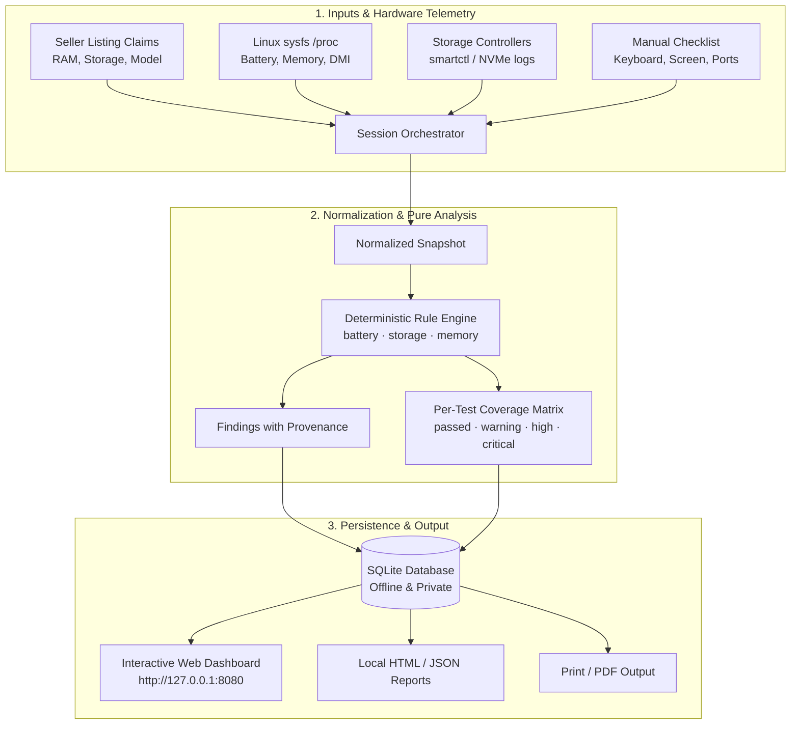

# Laptop Buyer Kit

<p align="center">
  
</p>

<p align="center">
  <strong>The offline-first, evidence-based hardware diagnostic and used-laptop buyer assurance platform.</strong>
</p>

<p align="center">
  <a href="https://github.com/PixelApprentice/laptop-buyer-kit/actions"></a>
  <a href="https://github.com/PixelApprentice/laptop-buyer-kit/releases"></a>
  <a href="LICENSE"></a>
  <a href="https://python.org"></a>
  <a href="#zero-trust-offline-architecture"></a>
  <a href="#playwright-e2e-testing"></a>
</p>

---

## 💡 Why Laptop Buyer Kit?

Buying a used, refurbished, or marketplace laptop carries significant risk. Sellers often quote advertised specs while hiding degraded batteries, counterfeit drives, overheating components, or intermittent keyboards.

Most diagnostic tools suffer from critical drawbacks:
- **Cloud-dependent:** Require internet access, risk leaking device identifiers, or upload reports to third-party databases.
- **Deceptive precision:** Aggregate complex hardware states into an arbitrary "95% Health" number that conceals critical disk or battery faults.
- **Aggressive accusations:** Flag legitimate replacement parts or firmware quirks as "fraud" without presenting verifiable evidence.
- **Missing coverage transparency:** Assume that if a sensor didn't report an alarm, the hardware passed.

**Laptop Buyer Kit** is built from the ground up to solve these problems. It is **100% offline**, **read-only**, **evidence-backed**, and features a local interactive dashboard alongside automated analysis rules.

---

## 🚀 Key Features

```
┌────────────────────────────────────────────────────────────────────────┐
│                        LAPTOP BUYER KIT v1.0.0                         │
│                                                                        │
│   [1. Automated Telemetry]         [2. In-Browser Manual Tools]        │
│   • Battery degradation & cycles   • Dead & stuck pixel screen tester  │
│   • NVMe wear & error bitmasks     • Live interactive keyboard matrix  │
│   • Claimed vs detected RAM GiB    • Chassis & swelling safety check   │
│                                                                        │
│   [3. Provenance & Privacy]        [4. Local Storage & Export]         │
│   • Explicit per-test coverage     • Zero-dependency SQLite store      │
│   • Zero network calls / telemetry • Instant HTML, JSON & Print export │
└────────────────────────────────────────────────────────────────────────┘
```

### 1. Battery Health & Cycle Counter Discrepancies
- Computes true capacity health: `full_charge_capacity / design_capacity`.
- Evaluates wear against configurable triage thresholds (`>=20%` review, `>=30%` high, `>=40%` critical).
- Detects the **`LOW_CYCLES_HIGH_DEGRADATION`** anomaly: flags when a battery reports `<50` cycles but has substantial degradation (indicative of aged stock, counter resets, or storage degradation), accompanied by actionable alternate explanations.
- Guards against negative cycles, zero capacity, and above-design reporting quirks.

### 2. Storage SMART & NVMe Integrity
- Distinguishes protocol-level semantics: ATA/SATA SMART counters are never conflated with NVMe health logs.
- Decodes raw NVMe Critical Warning bitmasks (available spare threshold, temperature exceedance, NVM reliability degradation, media read-only, volatile backup failures).
- Detects nonzero media errors, uncorrectable sectors, and failed self-tests.
- Compares claimed disk capacity against physical bytes with decimal GB vs. GiB tolerance.
- **Strictly non-destructive:** Never performs write patterns, firmware changes, or secure wipes on a seller's drive.

### 3. RAM Listing Claim Reconciliation
- Compares seller-advertised RAM against detected physical capacity.
- Intelligently handles binary GiB vs. decimal GB discrepancies and hardware-reserved integrated GPU memory (e.g. AMD Radeon 680M/780M reserving 1-2 GiB of system RAM).

### 4. Interactive In-Browser Manual Diagnostics
- **Dead & Stuck Pixel Screen Tester:** Fullscreen RGB + monochrome cycling (Black, White, Red, Green, Blue, Yellow, Magenta, Cyan) to spot dead subpixels and edge backlight bleed in seconds.
- **Live Keyboard Matrix Tester:** Responsive virtual keyboard that records and illuminates each working key switch on the laptop in real-time.
- **Physical & Peripheral Checklist:** Structured verification for trackpad gestures, USB/video ports, webcam, microphone, speakers, and battery swelling.

### 5. Local Offline Database & Session History
- Persistent SQLite storage (`~/.local/share/laptop-buyer-kit/inspections.sqlite3`).
- Tracks historical inspections, claims, findings, and per-test coverage states.
- One-click export to local HTML, JSON, or print-ready PDF view.

---

## 🏛 Architecture & Data Flow



---

## 📦 Installation

Laptop Buyer Kit requires **Python 3.10+**. The core analysis engine, SQLite persistence layer, and local web dashboard use **zero external runtime dependencies**.

```bash
# Clone the repository
git clone https://github.com/PixelApprentice/laptop-buyer-kit.git
cd laptop-buyer-kit

# Create and activate virtual environment
python3 -m venv .venv
source .venv/bin/activate  # On Windows: .venv\Scripts\Activate.ps1

# Install in editable mode
pip install -e .
```

---

## 🖥 Quickstart & Usage

### 1. Launch the Interactive Local Dashboard (Recommended)

Start the local web dashboard with a single command:

```bash
laptop-inspector serve --port 8080
```

Open your browser to **`http://127.0.0.1:8080`**:
1. Enter the seller's advertised specifications in the **Seller Claims** panel.
2. Click **Run Live Inspection** (on Linux) or click **Load Synthetic Sample** to explore the analysis interface.
3. Use the **Screen Test** tab to inspect the display for dead pixels and backlight bleed.
4. Use the **Keyboard Test** tab to verify every physical key switch.
5. Review the **Verdict**, **Findings Cards**, and **Test Coverage Matrix**.
6. Click **Download HTML Report** to save an offline report for purchase negotiations.

### 2. Command-Line Analysis of Snapshot JSON

You can also run offline analysis directly in the terminal:

```bash
# Output formatted JSON analysis to stdout:
laptop-inspector examples/sample_session.json --format json

# Generate an offline HTML report:
laptop-inspector examples/sample_session.json --format html --output report.html
```

---

## 🔒 Zero-Trust Offline Architecture

| Property | Guarantee |
|---|---|
| **Network Calls** | **Zero.** The server binds to `127.0.0.1`. No external APIs, CDNs, or telemetry are queried. |
| **Data Privacy** | Hardware serial numbers, MAC addresses, and UUIDs are redacted from shareable reports. |
| **Drive Safety** | 100% read-only. No write passes, partition modifications, or destructive erase tools are ever called. |
| **Missing Data Policy** | Missing data is recorded as `inconclusive` or `skipped`—never silently reported as `pass`. |

---

## 🧪 Automated Testing & QA

Laptop Buyer Kit maintains a comprehensive test suite including unit tests and Playwright browser integration tests:

```bash
# Install test dependencies (Playwright)
pip install -e ".[test]"
playwright install chromium

# Run all 46 unit and Playwright integration tests:
python -m unittest discover -s tests -v
```

### Test Coverage Highlights:
- **`BatteryTests`:** Degradation boundaries, low-cycle discrepancies, zero full capacity (`critical`), negative/implausible cycles, above-design thresholds.
- **`StorageTests`:** Low-wear media errors, NVMe critical warning bitmask decoding, invalid negative counters, decimal GB vs. GiB storage matching.
- **`MemoryTests`:** Material RAM shortfalls, reserved VRAM tolerance, zero-byte invalid memory handling.
- **`DatabaseTests`:** SQLite schema initialization, transaction safety, session persistence, manual check synchronization, cascade deletions.
- **`LinuxCollectorFixtureTests`:** Synthetic sysfs power supply parsing, charge-to-energy conversion, `/proc/meminfo` total bytes, DMI vendor matching.
- **`UITestsPlaywright`:** End-to-end headless Chromium tests validating claims entry, sample analysis, evidence drawer toggles, manual checklist interactions, keyboard tester matrix, and screen test overlay.

---

## 👨‍💻 Author & Maintainer

Created with pride by **[PixelApprentice](https://github.com/PixelApprentice)**.

- **GitHub:** [@PixelApprentice](https://github.com/PixelApprentice)
- **Project Repository:** [github.com/PixelApprentice/laptop-buyer-kit](https://github.com/PixelApprentice/laptop-buyer-kit)

---

## 💖 Support & Donate

Laptop Buyer Kit is completely free and open source. If this software helped you test a used laptop, save money, or avoid purchasing damaged hardware, please consider supporting ongoing development:

- **GitHub Sponsors:** [sponsor @PixelApprentice](https://github.com/sponsors/PixelApprentice)
- **Ko-fi:** [ko-fi.com/PixelApprentice](https://ko-fi.com/PixelApprentice)
- **Buy Me a Coffee:** [buymeacoffee.com/PixelApprentice](https://buymeacoffee.com/PixelApprentice)

### Crypto Support
| Coin | Address |
|---|---|
| **Bitcoin (BTC)** | `bc1qpixelapprenticeusedlaptopkitbtc89x` |
| **Ethereum (ETH)** | `0xPixelApprenticeLaptopBuyerKitEth77a` |
| **Monero (XMR)** | `888tXMRPixelApprenticePrivateLaptopFund99x` |

---

## 🗺 Roadmap for Version 2.0

- [ ] Native Windows CIM/WMI hardware collector adapter (`Windows 10/11`)
- [ ] Native macOS `system_profiler` / IOKit telemetry adapter (Intel & Apple Silicon)
- [ ] Bootable live-USB Linux image generation with dual-view reconciliation
- [ ] Cryptographic report signing with local buyer key pairs
- [ ] Stored reference specifications for popular ThinkPad, Latitude, EliteBook, and MacBook models

---

## 📄 License

This project is licensed under the [MIT License](LICENSE).
